 

AI Engineering student focused on **AI Security** and **Purple Teaming**. 
Open to **internships and junior roles in AI / ML and security**.

<picture>
  <source media="(prefers-color-scheme: dark)" srcset="assets/stack-dark.svg" />
  
</picture>
<picture>
  <source media="(prefers-color-scheme: dark)" srcset="assets/stats-dark.svg" />
  
</picture>

### Roadmap &nbsp;·&nbsp; what I'm working towards right now

<table>
<tr>
<th>Certifications</th>
<th>Projects</th>
</tr>
<tr>
<td valign="top">

- Fortinet Certified Fundamentals (NSE 1–3)
- AttackIQ: AI Security · MITRE ATT&CK
- Claude Academy: MCP · Evals
- Hugging Face: AI Agents · MCP
- Qualys VMDR
- Microsoft Applied Skills: Sentinel SIEM · MCP agents in Foundry · GitHub secret scanning
- PortSwigger Web LLM Attacks labs

</td>
<td valign="top">

- **mcp-purple-lab** Red + blue lab for AI agents and MCP servers: automated attacks, guardrails and SIEM alerts
- **sentinel-kql-detections** KQL detection rules mapped to MITRE ATT&CK, with response playbooks
- **ai-sec-writeups** LLM audit methodology and notes from offensive labs

</td>
</tr>
</table>

